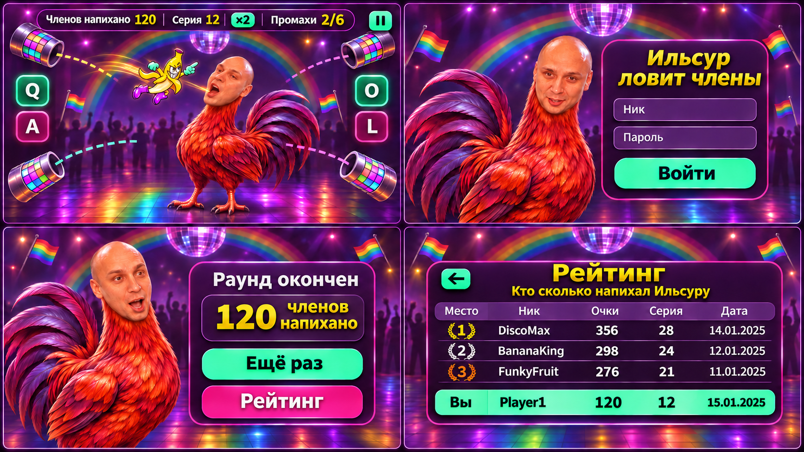
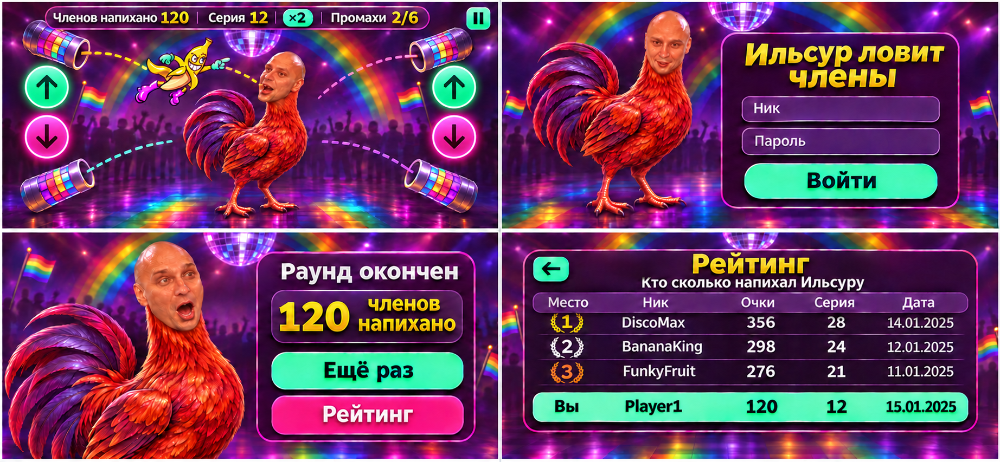

# Персонаж и визуальные макеты

Статическая дизайн-спецификация задачи 04 для будущей реализации игры.
Концепция и два макета утверждены владельцем. Игровая логика, экраны,
управление и графические ассеты здесь описаны как требования, но ещё
не реализованы.

Карточки: [задача 04](https://trello.com/c/aeyRJg77),
[правила MVP](https://trello.com/c/G0qujK0t).
Согласованные игровые правила также записаны в [game-rules.md](game-rules.md).

## Утверждённые макеты

Ниже — проверенные версии для компьютера и горизонтального телефона.
В игровом HUD указано «Членов напихано 120»; экран окончания раунда
показывает «120 членов напихано» и кнопку «Рейтинг». Над таблицей стоят
заголовок «Рейтинг» и подзаголовок «Кто сколько напихал Ильсуру».

### Компьютер

### Горизонтальный телефон

## Название и художественное направление

Название игры — **«Ильсур ловит члены»**. Стиль — яркая радужная
ЛГБТ-дискотека с неоновым танцполом, зеркальным шаром, радужными флагами,
цветными лучами и силуэтами танцующей толпы. Палитра и свет должны
поддерживать читаемость игрового поля и HUD.

Главный герой — комический персонаж с телом красного петуха и согласованной
человеческой головой, сохраняющей узнаваемость исходного лица. Макеты
показывают героя на сцене и крупным планом в меню и экране окончания раунда.
Утверждённые макеты служат визуальной целью, а не готовыми игровыми ассетами.

Четыре радужные диско-пушки стоят по краям игрового поля: верхняя и нижняя
с каждой стороны. Они задают четыре траектории обычных мультяшных бананов.
Банан изображается отдельным персонажем с лицом, конечностями и ботинками;
его графика должна заменяться независимо от сцены, героя и пушек.

## Экраны

Все четыре экрана предусматриваются для рабочего стола и горизонтального
телефона. Целевые размеры из карточки — 1280×720 и 844×390 соответственно.
На широком экране сохраняется свободная центральная область игры и понятное
разделение боковых элементов. На телефоне в горизонтальном положении HUD,
поле и сенсорные зоны уплотняются, сохраняя крупные элементы управления.

| Экран         | Компьютер                                                                                                                                     | Горизонтальный телефон                                                                                                                                                        |
| ------------- | --------------------------------------------------------------------------------------------------------------------------------------------- | ----------------------------------------------------------------------------------------------------------------------------------------------------------------------------- |
| Игра          | Герой и четыре траектории занимают центр. Пушки и обозначения Q/A/O/L расположены по краям. HUD идёт сверху, пауза — отдельная кнопка справа. | Игровое поле остаётся в центре. HUD располагается вдоль верхнего края; большие верхние и нижние сенсорные кнопки находятся слева и справа, пауза остаётся доступной отдельно. |
| Вход          | Герой занимает левую часть сцены; справа — название игры, поля ника и пароля и кнопка «Войти».                                                | Герой и панель входа размещаются рядом по горизонтали; поля и кнопка остаются удобны для касания.                                                                             |
| Раунд окончен | Герой сопровождает панель с итоговым счётом и действиями «Ещё раз» и «Рейтинг».                                                               | Герой и компактная панель результата располагаются рядом; обе кнопки остаются крупными и различимыми.                                                                         |
| Рейтинг       | Таблица показывает место, ник, очки, серию и дату; своё место выделено отдельно.                                                              | Таблица использует ширину экрана; список прокручивается, строка игрока выделена.                                                                                              |

Макеты рейтинга содержат демонстрационные строки. В игре данные должны
приходить из рейтинга, описанного в [правилах MVP](game-rules.md): топ-20
и собственное место игрока.

## Управление

На компьютере клавиши соответствуют позициям захвата:

- `Q` — слева сверху;
- `A` — слева снизу;
- `O` — справа сверху;
- `L` — справа снизу;
- `Esc` — пауза.

На телефоне используются четыре большие сенсорные зоны: верхняя и нижняя
слева, верхняя и нижняя справа. Они соответствуют тем же четырём позициям.
Пауза вызывается отдельной экранной кнопкой. Игра рассчитана на
горизонтальную ориентацию телефона.

## HUD и состояния героя

Во время игры HUD показывает:

- текущие очки;
- длину серии;
- множитель серии;
- число промахов из шести;
- кнопку паузы.

Правила начисления и поражения не задаются макетом заново: они определены
в [game-rules.md](game-rules.md). Экран окончания раунда показывает итоговый
счёт и переходы к повторной игре или рейтингу.

Для героя нужны четыре визуальных состояния:

1. **Фокус** — герой следит за игровым полем и ожидает банан.
2. **Попадание** — реакция на успешный захват.
3. **Промах** — отдельная реакция на пропуск.
4. **Поражение** — выражение для окончания раунда.

Конкретные промежуточные кадры, длительность и способ перехода между позами
определяются при реализации. Они не должны менять правила игры или блокировать
управление.

## Ассеты

Размеры ниже — ориентиры из карточки 04. Это требования к будущим файлам,
а не включённые в этот документ изображения.

| Ассет             | Формат и ориентир                      | Требования                                                                       |
| ----------------- | -------------------------------------- | -------------------------------------------------------------------------------- |
| Фон дискотеки     | WebP, 2560×1440                        | Сцена с местом для поля и экранных панелей.                                      |
| Герой             | WebP, 512×512 на позу, с альфа-каналом | Отдельная графика для каждого необходимого состояния; лицо не сливается с фоном. |
| Диско-пушка       | WebP, 256×256                          | Четыре экземпляра по краям поля; направление траектории видно.                   |
| Банан-персонаж    | PNG, 128×128, с альфа-каналом          | Самостоятельный заменяемый спрайт, отделённый от фона и пушек.                   |
| Иконки интерфейса | SVG                                    | Масштабируются без потери чёткости; состояние паузы понятно.                     |

## Границы реализации

Этот документ фиксирует дизайн задачи 04. Canvas, HTML/CSS-экраны,
анимации, обработчики клавиш и касаний, игровые правила, вход, рейтинг
и производство графических ассетов остаются в своих последующих задачах.
Технические границы клиента описаны в [architecture.md](architecture.md).
